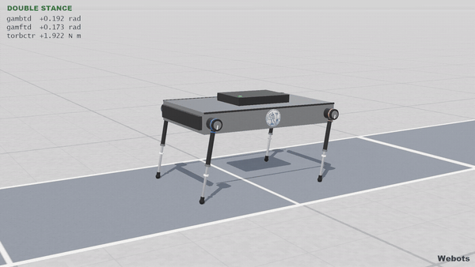
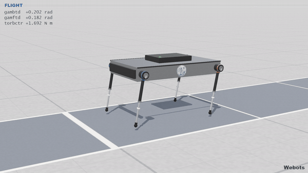
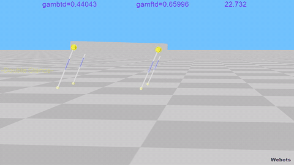
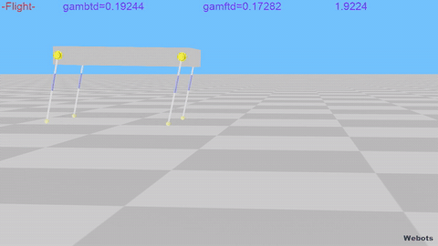

# Quad Controller (2012–2014) on Webots R2025a

This folder is a port of the NTUA quadruped bounding simulation (Webots 7.3/7.4, MATLAB
controllers, Windows physics plugins) to Webots R2025a on Linux. The originals in
`../Webots_FINAL` and `../Webots FINAL 2` are untouched.

| Folder | Port of |
|---|---|
| `Webots_FINAL/` | `../Webots_FINAL` (Feb 2013 thesis version, one world) |
| `Webots_FINAL_2/` | `../Webots FINAL 2` (Feb–Oct 2014, 15 worlds) |
| `tools/` | world converter, options translator, texture generator, movie recorder, tuned-world and showcase-world generators |
| `media/` | GIFs for this page (`media/gif`), made from movies recorded headless on this machine: the showcase Oct and Feb 2013 worlds, the tuned ones with the 2014 look, the Oct world as converted (gait lost after about 6 s), and the same two controllers on MuJoCo. The movies themselves (`media/*.mp4`, up to 1080p, with the controller's HUD and the engine's name in the lower right corner) are not in the repository; `run_headless.sh` and `mujoco/run_controller.py` render them |
| `plots/` | figures from the controllers' logs (forward velocity, CoM height, pitch, phase planes, gait diagram, leg angles, per-gait convergence, CoM path, speed tracking, before/after tuning, Webots versus MuJoCo) with a [README](plots/README.md) |
| `mujoco/` | the robot as a MuJoCo 4.0 model, running the same Python controllers unchanged; see its [README](mujoco/README.md). Also published on its own as [quad-bounding-mujoco](https://github.com/mastns/quad-bounding-mujoco) |

Three kinds of world sit side by side:

- `X.wbt`: the faithful conversion, with the 2014 look and parameters.
- `X_tuned.wbt`: one documented physics edit so the gait works (see "Tuned worlds").
- `X_showcase.wbt`: the tuned world with a new look. Its physics is identical to the tuned world,
  checked bit for bit (see "Showcase worlds").

## In motion

| Oct 2014 world, showcase look (desired speed 0.9 m/s) | Feb 2013 thesis world, showcase look (0.7 m/s) |
|---|---|
|  |  |

| Oct 2014 world as converted: the gait is lost after about 6 s | The same world tuned (world CFM 1e-5), 2014 look |
|---|---|
|  |  |

The same controllers on the MuJoCo model are shown in [mujoco/README.md](mujoco/README.md).

Webots R2025a is installed in `~/webots` (tarball, no sudo needed); `webots` is on the PATH through
`~/.local/bin/webots`. A private Xvfb (for running without a display) is in `~/.local/opt/xvfb`.

## Running

With a display (this machine's desktop, `ssh -X`, or a remote desktop):

```bash
./run_world.sh                                   # Webots_FINAL_2/worlds/SUPERVISOR_webots743_Oct_showcase.wbt
./run_world.sh Webots_FINAL/worlds/SUPERVISOR_webots730_Feb_FINAL_showcase.wbt
./run_world.sh Webots_FINAL_2/worlds/SUPERVISOR_webots743_Oct.wbt          # as converted, 2014 look
```

Without a display:

```bash
./run_headless.sh Webots_FINAL_2/worlds/SUPERVISOR_webots743_Oct_showcase.wbt 20    # fast, console only
QUADSIM_MOVIE_SIZE=1920x1080 ./run_headless.sh Webots_FINAL_2/worlds/SUPERVISOR_webots743_Oct_showcase.wbt 20 oct.mp4
```

`run_headless.sh` adds a small helper supervisor (`controllers/movie_recorder`) to a temporary copy of
the world; it records the movie, writes "Webots" in the lower right corner of the view, and ends the
run after the requested time.

Plots: `python3 tools/collect_plot_data.py`, then `~/.local/opt/quadsim-venv/bin/python tools/make_plots.py`
(a venv with matplotlib and numpy; details in [plots/README.md](plots/README.md)).

Each controller writes its logged arrays (the MATLAB `W*p` variables) to
`controllers/<name>/data/<name>_<date>_steps.csv` (one row per ms) and `..._gaits.csv` (one row per
liftoff). That happens at the stop condition (MATLAB: `desktop; keyboard;`) or when Webots closes.

Environment variables:

- `QUADSIM_AT_STOP`: `pause` (default in the GUI: pause once, like `keyboard`), `continue` (default
  in `run_headless.sh`), or `quit`.
- `QUADSIM_KEYBOARD`: `pause` (default) or `ignore`. Only `controller_thalis_oct` uses it: its MATLAB
  called `keyboard` at every step.
- `QUADSIM_LOG_DIR`: where the CSV logs go (default `data` inside the controller folder).
- `QUADSIM_LABELS`: style of the controllers' on-screen labels (in Webots and in MuJoCo videos).
  - `clean` (default): a small HUD with the phase in a fixed, colour-coded line and the liftoff
    values aligned, with units.
  - `original`: the labels as the MATLAB drew them.
  - `off`: no labels.
- `QUADSIM_BADGE`: the engine's name that `run_headless.sh` movies carry in the lower right corner
  (default `Webots`; empty for none). MuJoCo videos get theirs from `run_controller.py --badge`.

## What the port changes

### Worlds (`tools/convert_v7_world.py`)

The worlds keep their original Y-up frame (`WorldInfo { coordinateSystem "NUE" }`), so the robot,
sensor axes, physics plugin and controller math are unchanged. The converter does the following:

- **Supervisor**: becomes `Robot { supervisor TRUE }`; `showRobotWindow` is dropped.
- **Position feedback**: each joint gets a `PositionSensor` named `<motor>_sensor`, because Webots 8
  moved position feedback out of the motors.
- **Cylinders**: each one is rotated −90° about x, because R2022a moved the cylinder axis from y to z.
  Where a `Pose` holds only the cylinder, the rotation is folded into that `Pose`; a DEF that is
  reused (`boundingObject USE UPP_LEG`) moves to the wrapper.
- **Viewpoint**: its orientation is re-expressed for the R2022a camera convention.
- **Transform**: becomes `Pose`, which R2023b requires inside a `boundingObject`.
- **Removed PROTOs**, replaced by plain nodes so nothing is downloaded:
  - `Floor` / `MetricFloor` become a `Solid` with an infinite `Plane` and the same
    `contactMaterial`; the textures are generated by `tools/make_textures.py`.
  - `WoodBox` becomes a static box.
  - `SphericalSkyDome` is dropped; the sky colour stays.
- **Textures**: absolute paths (`D:/Drive/...`, `M:/Drive/...`) become `textures/<file>`.
- **Webots_FINAL world**: it had no controller or plugin set (Webots 7 saved the default "void"), so
  the converter gives it the folder's only ones: `controller_webots730_Feb_FINAL` and
  `physics_webots730_Feb_FINAL`. Without the plugin, the controller has no body velocity input.

Physical parameters (masses, inertias, springs, contact properties, CFM/ERP) are left as they were.
The three `*_tuned.wbt` copies each change one of them; see "Tuned worlds".

### Physics plugins

The C code is unchanged except for two things:

- `webots_physics_init()` now takes no arguments.
- The Makefiles use the current way of writing a space: GNU make 4.x reads the old `space +=` idiom
  differently and broke the Webots path.

Build with `make` in each plugin folder (with `WEBOTS_HOME=~/webots` set). The `.so` files are
already built.

### Controllers (MATLAB → Python)

There is no MATLAB on this machine, so every controller used by a world was ported to Python:

- `gtd_controller8.py` and `y_th_model_fpfind3_2.py` were translated mechanically. A round-trip check
  found all 67 statements token-identical to the MATLAB. They run in real arithmetic and fall back to
  complex arithmetic only where MATLAB would have gone complex (for example `asin` outside ±1); in
  that case they print a warning and take the real part.
- `controller_options.py` files were generated from the `.m` files by `tools/port_options.py`.
- The main scripts follow the MATLAB line by line. `matlab_port.py` holds the stand-ins: `rotz`,
  `num2str`, `strcat`, `keyboard`, CSV logging, the label style (`set_label`), and so on.
- **Torque direction.** Webots up to 8.5 applied `wb_motor_set_force` the wrong way round on a
  `HingeJoint` whose parent and endPoint both have Physics. Webots 8.6.0 fixed this: *"Fixed
  HingeJoint and Hinge2Joint rotation direction in case of motor torque control…"*. The MATLAB code
  was tuned against the old behaviour (`torbctr = -out(3)/legs  % Match Webots Positive direction`).
  The ports send stance torques through `set_force_webots7()`, which reproduces the old direction.
  Without it, the controller pushes the robot backwards when it should speed it up.

Two controllers could not have run as saved, even in MATLAB, so the ports make a choice:

- `controller_thalis_oct` had no `controller_options.m`, so MATLAB would have stopped. It uses the
  options of `controller_webots740_Feb_FINAL`, the family it was copied from.
- `controller_webots743_May_flat` was mid-edit: it read `Foot1_Gps` and the other foot GPS devices,
  but the lines that create them were commented out. The port uses the foot GPS and touch sensors
  when the world has them (only `..._touch66` has all of them); otherwise those readings are zero and
  the force-angle-margin block is skipped. `SUPERVISOR_thalis_sept` has no leg-1 spring; its reading
  is NaN, so the state machine stays idle.

Not ported, because no world uses them:

- `controller_webots743_May_2` uses an undefined `L1`.
- `controller_webots743_Oct` targets a robot with `hip1..4` devices that is not in these worlds.
- `my_controller_notouch` has no helper files.
- The MATLAB backup copies inside controller folders and `plotting.m`.

Also not converted: `../Webots_FINAL/SUPERVISOR_webots730_Feb_FINAL.wbt`, an older copy outside
`World/` with inverted spring axes.

## How it behaves on R2025a

All 16 converted worlds load and run without errors. Their controllers start, and the physics plugin
applies its 4 ms push and streams body velocity and orientation to the controller. There are no
recordings of the 2013–2014 runs to compare against, so nothing below is checked against Webots 7.4
itself. Results are from 60 s headless runs; "liftoffs" are flight phases, about 4.2 per second in a
steady gait.

### As converted

| World | Result |
|---|---|
| `Webots_FINAL_2`: `...730_Feb_FINAL`, `...740_Feb_FINAL`, `...740_Feb_FINAL_void_THALIS_test` | Steady gait for the whole run: 0.67 m/s liftoff speed (target 0.7), pitch under 0.02 rad, no torque saturation. |
| `Webots_FINAL_2`: `...743_Oct`, `...743_May_(flat)` | About 19 hops, then the robot settles into standing (after about 6 s). The hip torque requests grow past `maxTorque` and some `gtd_controller8` results go complex. |
| `Webots_FINAL/...730_Feb_FINAL` | Legs 2–4 are rigid, so the gait never forms. Their springs point down (see below). |
| Slope and in-progress worlds: `...743_May_2`, `..._touch66`, `..._(slope)touch`, `..._notouch`, `..._notouch2` | A few hops, then the robot falls or stands. |
| Passive and test worlds: `..._void`, `...741_Mar_FINAL`, `...742_May_FINAL`, `..._notouch3`, `thalis_sept` | Run as expected: the robot drops, lands and stands. |

### Tuned worlds

`tools/make_tuned_worlds.py` writes three `*_tuned.wbt` copies, each one edit away from its converted
twin. The converted worlds are unchanged.

| Tuned world | Edit | Result |
|---|---|---|
| `Webots_FINAL_2/worlds/SUPERVISOR_webots743_Oct_tuned.wbt` | WorldInfo `CFM` 1e-10 → 1e-5 | Steady for the whole run: 249 liftoffs, 0.78 ± 0.01 m/s (target 0.9), pitch about 0.02 rad at most, no saturation, no complex results |
| `Webots_FINAL_2/worlds/SUPERVISOR_webots743_May_(flat)_tuned.wbt` | same | Steady, 0.77 m/s |
| `Webots_FINAL/worlds/SUPERVISOR_webots730_Feb_FINAL_tuned.wbt` | springs 2–4 axis `0 -1 0` → `0 1 0` | Steady, 0.665 m/s (target 0.7) |

**Why the CFM change is numerical, not physical.** At ERP 0.1 and a 1 ms step, CFM 1e-5 still
holds a joint to about 10 µm under 100 N, so the robot's joints stay rigid. What fails at 1e-10 is
the constraint solver. In the May–Oct 2014 worlds, each foot touches the ground through a 0.1 g
touch-sensor body attached to a 2.5 g foot with inertia [10, 10, 1e-8], on default soft contacts.
Webots warns about that mass ratio when the world loads. The evidence that this is conditioning:

- Three unrelated changes each restore a steady gait (0.65–0.85 m/s): joint `CFM` of 1e-9 or more,
  contact `softCFM` of 1e-4 or less, or letting the 1 cm foot sphere rather than the touch-sensor
  sphere carry the contact.
- The Feb-era worlds, which have stiff contacts and no touch sensors, bound as converted even with
  `CFM` 1e-16.

CFM 1e-5 is the Webots default. It replaces your 1e-10, but leaves the contact properties and every
other physical parameter as you had them; in practice only the solver's regularisation changes.

**Why the Feb 2013 edit is a correction, not a retune.** In that file, springs 2–4 have axis
`0 -1 0` with travel 0 to 0.035 m. Ground contact pushes them to negative positions, so they sit on
their 0 stop and the legs are rigid. The history in your files: the copy at the project root has all
four pointing down, the `World/` copy has leg 1 flipped up, and every 2014 world (including the 2014
copy of this same world) has all four pointing up. The tuned copy just finishes that change.

**The controller is in charge.** In the tuned Oct world, changing only `xddes` (0.6 / 0.9 / 1.1 m/s)
gives steady liftoff speeds of 0.51 / 0.78 / 0.92 m/s. That is about 15 % under target each time,
which looks like model mismatch. The steady gait is pronk-like, as the controller's fixed point (zero
pitch at apex) implies. Each 243 ms cycle has the back legs landing about 12 ms before the front,
about 95 ms of double stance, then about 130 ms of flight, with pitch within ±0.02 rad.

**Left as is:**

- R2025a's joint springs are implicit, which adds h·k = 3.4 N·s/m to each leg's 8 N·s/m damper. The
  model assumes 8. Changing it did not fix the converted worlds, and the tuned worlds work without it.
- The slope experiments (`...743_May_2`, `..._touch66`, `..._(slope)touch`) and the
  `controller_webots743_May_flat` runs on flat ground (its `psia = 0.1` assumes a slope that is not
  there) still fail with every fix tried. Those were in-progress controllers, not a physics issue.

### Showcase worlds

`tools/make_showcase_worlds.py` writes `*_showcase.wbt` from each tuned world. Only visual nodes
change:

- **Robot.** The body box, upper-leg rod, lower-leg rod and foot spheres are also the collision
  shapes, so they keep their geometry and only get new PBR materials (brushed aluminium, carbon,
  chrome, rubber). Everything else is new, visual only, and added as a sibling, never inside a node
  used as a `boundingObject`:
  - hip motors with a colour ring per leg pair (orange back, blue front) and an index mark that turns
    with the leg;
  - carbon sleeves, chrome rods, and a collar on each rod whose gap to the sleeve shows the spring
    travel;
  - rubber boots on the feet;
  - an electronics module with a status LED, bumpers and edge trims;
  - the NTUA Control Systems Lab logo (your `ntua3.png`) on both sides.
- **Scene.** A soft gradient sky that also lights the PBR materials (generated HDR maps), a sun that
  casts shadows plus a fill light, a light floor with a 1 m grid, a running lane along the robot's
  path with a tick every metre (thicker every 5 m), a wooden crate in place of the plain box, and a
  3/4 camera that tracks the robot closely.

Everything is generated locally (`worlds/textures/studio_sky_*`, `floor_tiles.png`, `lane_5m.png`,
`crate_wood.png`), so nothing is downloaded. Over 15 s, the logged trajectory of each showcase world
is bit-identical to its tuned world: 15,000 steps, every value equal, for both Oct and Feb.
