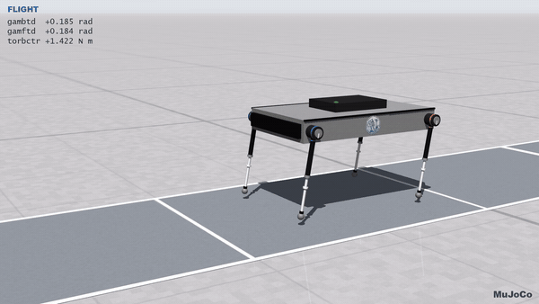
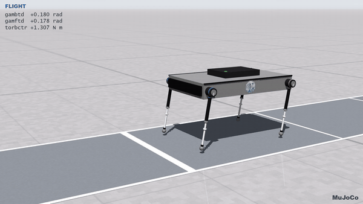

# The quadruped on MuJoCo 4.0

The same Python controllers as the Webots port run here unchanged, on a MuJoCo model of the robot.

| Oct 2014 controller (desired speed 0.9 m/s) | Feb 2013 thesis controller (0.7 m/s) |
|---|---|
|  |  |

| File | What it is |
|---|---|
| `make_model.py` → `quad.xml`, `textures/lane.png` | the robot and scene as MJCF, every number taken from `SUPERVISOR_webots743_Oct.wbt` |
| `webots_api/controller.py` | the part of the Webots controller API the controllers use, on top of MuJoCo |
| `run_controller.py` | runs a controller folder unchanged: headless, with video, or in the interactive viewer |
| `hud.py` | draws the controller's labels and the "MuJoCo" badge on video frames, as Webots draws them |

## Running

```bash
PY=~/.local/opt/quadsim-venv/bin/python        # mujoco 4.0.0 + numpy + Pillow (any such Python works)
$PY run_controller.py                                           # Oct 2014 controller, 30 s, headless
$PY run_controller.py --video oct.mp4 --size 1920x1080          # video with the HUD and badge (EGL, no display needed)
$PY run_controller.py --viewer                                  # interactive viewer, real time (needs a display)
$PY run_controller.py --controller ../Webots_FINAL/controllers/controller_webots730_Feb_FINAL \
                      --start-height 0.34 --start-rotation -0.01  # Feb 2013 thesis version
```

The controller's CSV logs (its `W*p` arrays) go to `mujoco/data/<controller>/` or to `--log-dir`. The
`QUADSIM_*` variables work as in Webots, except that a run here never pauses. On this machine 30 s of
simulation take about 2.3 s, and a 20 s 1080p video takes about 8 s.

A video shows what a Webots movie shows: the controller's labels (`QUADSIM_LABELS`, same HUD) and the
engine's name in the lower right corner (`--badge`, `""` for none). Its camera glides along the lane
at a fixed height, following a low-pass filtered body position, so the body's hops show in the frame
(`--camera track` bolts it to the body instead, as the model's camera is).

## How the controller is connected

The controller file is executed as-is. Its `from controller import Supervisor` resolves to
`webots_api/controller.py`, which serves the same devices under the same names: `servo1_rot`…, their
position sensors, `spring1`…, `CoM_Gyro`, `CoM_Gps`, `CoM_Accelerometer`, `leg_gyro_n_1`, `CoM_Receiver`,
`CoM_DistanceSensor` and `TOUCHSENSORn`. It also does three other jobs:

- **Frames.** MuJoCo is Z-up and the 2014 worlds were Y-up with the robot running towards −x. The model
  uses X = −x_webots (forward), Y = z_webots (left), Z = y_webots (up). The API converts every reading
  back (gyros, GPS, accelerometer and the body rotation matrix), so all of the controller's sign
  conventions still hold.
- **Physics plugin.** It does what `physics_webots743_May_2.c` did: the 4 ms push of −1101 N along the
  body x axis, and every 1 ms the three receiver packets (body velocity, the 1234 marker, and the
  rotation matrix). The plugin's planar projection becomes three root joints (slide X, slide Z, hinge Y).
- **Motors.** Position control is Webots' P velocity servo: v = 60·(target − q), limited to 12 rad/s
  and 6.5 N m. `setForce` is torque control limited to 6.5 N m, with the R2025a sign convention, so the
  controllers' `set_force_webots7()` keeps working as it does in Webots R2025a.
- **Labels.** `setLabel` keeps each label with its Webots geometry, and `hud.py` draws them on the
  video frames the way Webots does: the line box of the text is 0.5 × size × view height tall, from
  the label's top-left corner, in Webots' own font files (`~/webots/resources/fonts`; Liberation or
  DejaVu fonts when Webots is not installed). This was measured on R2025a movies, so the HUD of a
  MuJoCo video matches the one of a Webots video.

## Model

Masses, centres of mass, the 0.8 kg m² pitch inertia, the joint ranges, the 3400 N/m / 8 N s/m springs
with 0–35 mm travel and the 1 cm feet all come from the Webots world. Total mass is 10.9104 kg (your
`mt = 10.91`). Three Webots-only workarounds are dropped, because with planar root joints they have
nothing left to do:

- the 10 kg m² roll/yaw inertias on the leg parts;
- the 1 µm foot slider;
- the separate 0.1 g touch-sensor body.

Three choices are MuJoCo's own:

- **Physics substeps.** The controller still runs every 1 ms, but physics advances in 0.25 ms steps,
  four per controller step. MuJoCo limits need a time constant of at least two steps, and stiffer
  stops keep the lower legs from bouncing off their 0 mm stop at liftoff.
- **Contacts.** Stiff, critically damped contacts (`solref 0.0005 1`) and friction 1.5. Webots had
  infinite friction; the feet do not slip either way.
- **Look.** The visuals follow the Webots showcase worlds: brushed aluminium, hip motors with orange
  (back) and blue (front) rings, carbon sleeves, chrome rods, rubber feet, the CSL logo, the lane with
  metre ticks, the studio sky, the warm key light from the camera side with a cool fill, and the same
  3/4 camera framing (`fovy` 25° is the showcase viewpoint's 0.75 rad horizontal field of view on a
  16:9 frame). They reuse the textures in `../Webots_FINAL_2/worlds/textures`, except the lane:
  MuJoCo has no tone mapping, so `make_model.py` writes a lighter, slightly greyer copy to
  `textures/lane.png` that renders in the colour Webots shows. The lane is a non-colliding plane with
  a faint reflection, fog fades the floor into the sky's haze, shadows use an 8192² map over 4 m
  around the robot, and frames are rendered with 8× multisampling.

## Results against Webots R2025a

Steady state, second half of a 30 s run:

| Controller | Engine | Liftoff speed | Apex height | Gait period |
|---|---|---|---|---|
| Oct 2014, desired 0.9 m/s | Webots (tuned world) | 0.780 ± 0.009 m/s | 0.320 m | 0.242 s |
| | MuJoCo | 0.834 ± 0.004 m/s | 0.320 m | 0.243 s |
| Feb 2013, desired 0.7 m/s | Webots (tuned world) | 0.665 ± 0.011 m/s | 0.317 m | 0.235 s |
| | MuJoCo | 0.675 ± 0.008 m/s | 0.319 m | 0.241 s |

No torque or position request is clamped in either engine. The vertical limit cycles nearly coincide;
see `../plots/comparisons/webots_vs_mujoco.png`, and the full figure sets in `../plots/mujoco_oct2014`
and `../plots/mujoco_feb2013`.

The Feb 2013 controller detects touchdown at 0.1 mm of spring compression. MuJoCo's stops are not
quite as rigid as Webots' were, so about 1 liftoff in 100 is counted twice. The gait is unaffected.
Only the Oct 2014 and Feb 2013 controller families have been tested here.
